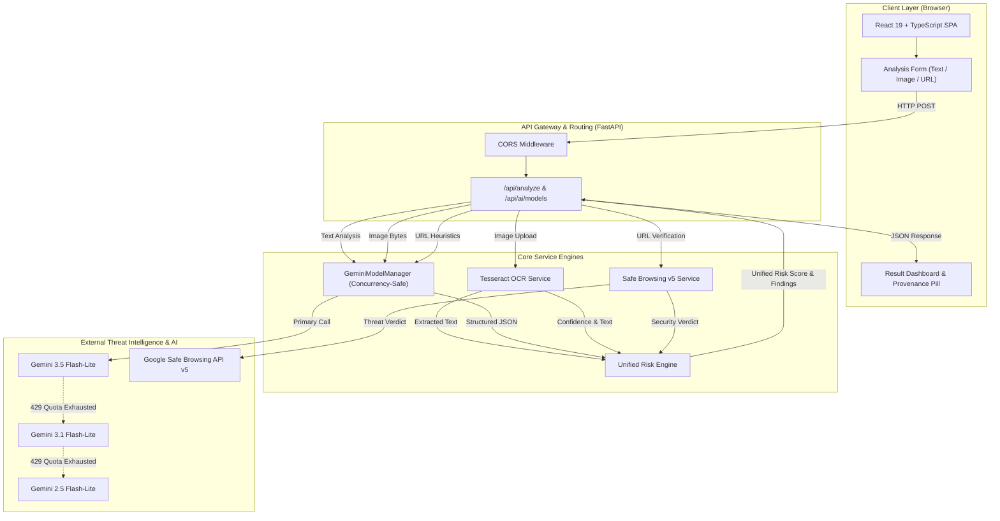
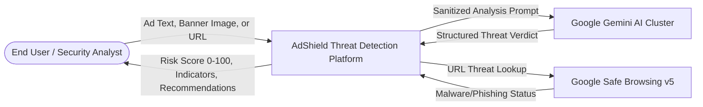
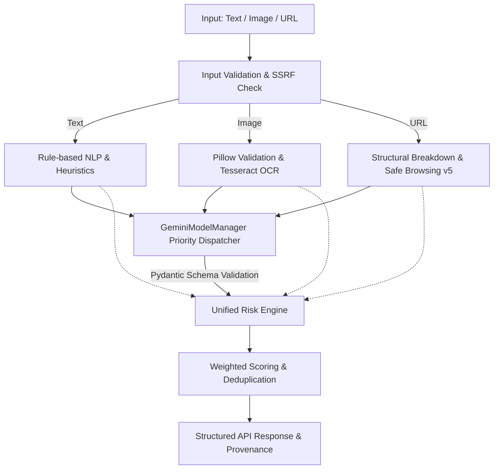
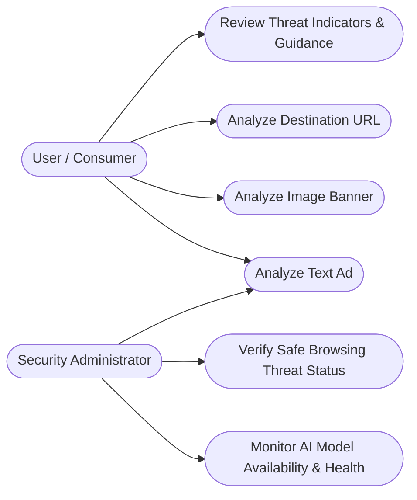
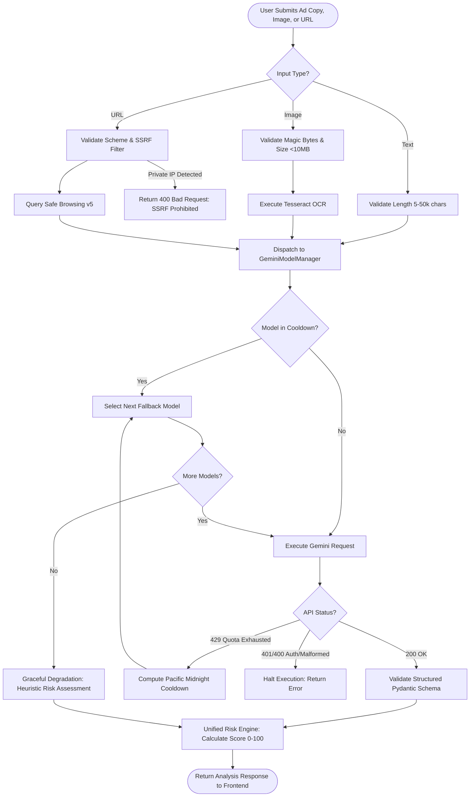
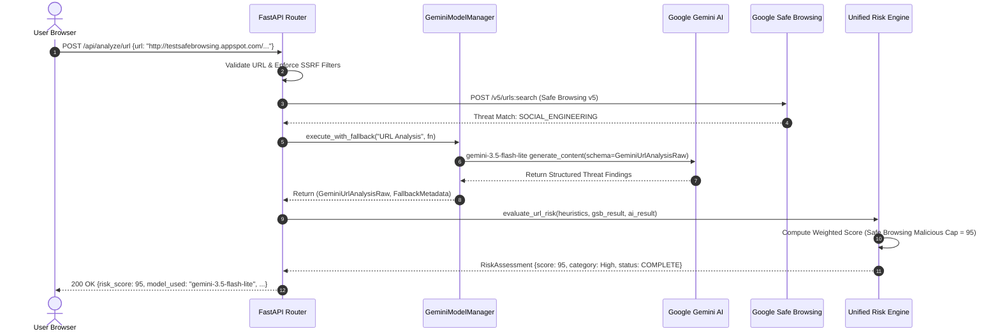

# AdShield – AI-Powered Fake Advertisement Detection System
## Comprehensive System Engineering & Technical Documentation

---

## 1. Project Overview

**AdShield** is an advanced, production-grade cybersecurity and artificial intelligence platform designed to detect fraudulent, misleading, and malicious online advertisements. Online advertising ecosystems across social media networks, search engines, and programmatic ad networks are increasingly inundated with malicious campaigns—ranging from counterfeit luxury sales and non-delivery scams to advance-fee prize lures, credential harvesting phishing operations, and tech support scams.

AdShield provides a multi-modal analysis architecture that inspects advertisement copy (text), display advertising assets (images and banners), and landing page destination links (URLs). The system operates on a zero-database, privacy-preserving paradigm that conducts real-time heuristic, optical, and large language model (LLM) evaluations without persisting user submissions or personal data in permanent storage.

---

## 2. Abstract

Online advertising fraud causes tens of billions of dollars in consumer losses annually while undermining trust in internet communications. Existing ad defense mechanisms rely predominantly on static blocklists, domain age thresholds, or manual human review, which fail against dynamically generated ad creatives, cloaked destination landing pages, and lookalike brand lures.

AdShield introduces a multi-tier detection architecture combining:
1. **Large Language Model (LLM) contextual semantic analysis** using Google Gemini AI models.
2. **Computer Vision & Optical Character Recognition (OCR)** powered by Google Gemini Vision and Tesseract OCR 5.4.0.
3. **Real-time threat intelligence and structural URL verification** via Google Safe Browsing API v5 and server-side request forgery (SSRF) filters.
4. **Automated multi-model resilience and quota management** ensuring zero service disruption under API throttling.
5. **Unified, weighted risk scoring** providing explainable threat telemetry on a 0–100 scale.

Implemented with Python FastAPI on the backend and React with TypeScript on the frontend, AdShield operates in a stateless, database-free environment that ensures rapid response times ($<2.5$ seconds) while guaranteeing complete data confidentiality.

---

## 3. Problem Statement

Modern malicious advertising (malvertising) exhibits four characteristics that confound traditional filters:
- **Evasion of Keyword Filters**: Attackers craft persuasive ad copy that avoids blatant trigger terms while applying high-pressure psychological manipulation (false urgency, counterfeit authority, artificial scarcity).
- **Steganographic and Text-Embedded Images**: Fraudulent claims and urgent payment instructions are frequently embedded directly into images to bypass text-only crawlers.
- **Dynamic Phishing Infrastructure**: Malicious destination URLs employ shorteners, typosquatting domains, open redirects, and cheap top-level domains (TLDs) that evade historical domain reputation databases.
- **Service Dependency & Quota Bottlenecks**: Production AI integrations are susceptible to free-tier rate limits (RPM/TPM) and daily request quotas (RPD), leading to service outages without resilient fallback architectures.

---

## 4. Existing System

Traditional anti-ad-fraud approaches rely on:
- **DNS Blocklists and Spam Filters**: Static lists of known malicious domains (e.g., Pi-hole, Spamhaus).
- **Client-Side Ad Blockers**: Regex matching on URL patterns and DOM cosmetic filtering (e.g., uBlock Origin).
- **Manual Content Moderation**: Post-campaign human review queues that react hours or days after victims have already been defrauded.

### Shortcomings of Existing Systems
| Feature | Traditional Systems | Impact / Vulnerability |
| :--- | :--- | :--- |
| **Reaction Time** | Retrospective (hours to days) | Zero-day fraud campaigns succeed before blocklist updates. |
| **Image Understanding** | None or basic hash matching | Visual text and deceptive imagery bypass filters. |
| **Contextual Reasoning** | Simple keyword regex | High false-positive rate on legitimate sales; fails on sophisticated lures. |
| **Explainability** | Binary block/allow | Users receive no actionable guidance on *why* an ad is dangerous. |

---

## 5. Proposed System

AdShield resolves these limitations through a hybrid detection pipeline:
- **Multi-Modal Inspection**: Concurrently evaluates text semantics, extracted image typography, computer vision visual inconsistencies, and network URL characteristics.
- **Multi-Source Evidence Fusion**: Blends rule-based pattern matching (NLP heuristics, regex catalog) with LLM contextual reasoning and Google Safe Browsing intelligence.
- **Resilient AI Pipeline**: Features an automated in-memory model manager with priority failover (`gemini-3.5-flash-lite` $\rightarrow$ `gemini-3.1-flash-lite` $\rightarrow$ `gemini-2.5-flash-lite`), live cooldown calculation until Pacific Time midnight, and graceful heuristic degradation.
- **Privacy & Database-Free Design**: Zero disk writes, zero user tracking, zero database dependencies.

---

## 6. Objectives

1. Develop a working full-stack detection web application capable of analyzing ad text, uploaded ad banners, and target URLs.
2. Integrate the official Google Gen AI Python SDK (`google-genai`) with structured JSON schema enforcement.
3. Incorporate Tesseract OCR 5.4.0 and Gemini Vision to extract and cross-verify image text against visual layout anomalies.
4. Integrate Google Safe Browsing API v5 to flag known malware, phishing, and unwanted software destinations.
5. Prevent Server-Side Request Forgery (SSRF) and private IP probing.
6. Provide an explainable, unified 0–100 risk score with categorized indicators, threat severity ratings, and actionable recommendations.
7. Engineer automated model fallback and daily quota management that operates seamlessly without live quota exhaustion.

---

## 7. Scope

- **In Scope**:
  - Analysis of text advertisement copy up to 50,000 characters.
  - Image analysis for JPEG, PNG, and WEBP assets up to 10 MB.
  - URL inspection, structural validation, SSRF checks, and Safe Browsing lookups.
  - Automated AI model priority failover across three Gemini models.
  - Interactive React + TypeScript user interface with real-time feedback and sample scenarios.
- **Out of Scope**:
  - User authentication, login credentials, and session persistence.
  - Database persistence (SQL, NoSQL, or cloud databases).
  - Active web crawling / executing JavaScript on destination websites.

---

## 8. Functional Requirements

- **FR-1**: Accept text advertisement copy and return contextual risk evaluation within 3 seconds.
- **FR-2**: Accept uploaded image files, validate magic bytes, perform OCR text extraction, conduct visual layout analysis, and return unified image risk telemetry.
- **FR-3**: Validate submitted URLs for RFC compliance, block private and loopback IP addresses, query Google Safe Browsing v5, and evaluate lookalike domain heuristics.
- **FR-4**: If the primary Gemini model encounters 429 quota exhaustion, immediately switch to the next configured fallback model without failing user requests.
- **FR-5**: Calculate daily quota cooldown dynamically based on time remaining until midnight in `America/Los_Angeles` (Pacific Time).
- **FR-6**: If all AI models are unavailable, return complete heuristic and threat intelligence results with `AssessmentStatus.PARTIAL`.
- **FR-7**: Expose a real-time model health endpoint (`GET /api/ai/models/status`) displaying availability, cooldown timers, and request counters.

---

## 9. Non-Functional Requirements

- **NFR-1 Performance**: End-to-end analysis latency $<2.5$ seconds under normal network conditions.
- **NFR-2 Security**: Complete credential isolation; zero API keys returned in API payloads or browser code.
- **NFR-3 Reliability**: 100% test pass rate across backend regression test suite; non-blocking fallback on external API timeouts.
- **NFR-4 Scalability**: Stateless backend architecture capable of horizontal scaling behind standard reverse proxies.
- **NFR-5 Usability**: Clean, responsive modern UI built with Tailwind CSS, responsive on mobile, tablet, and desktop viewports.

---

## 10. Technology Stack

### Frontend
- **Framework**: React 19, TypeScript 5.8
- **Build Tool**: Vite 8.3
- **Styling**: Tailwind CSS, PostCSS, Lucide React (icons)
- **State Management**: React Hooks (`useState`, `useCallback`)
- **HTTP Client**: Native browser `fetch` API

### Backend
- **Framework**: FastAPI (Python 3.9+)
- **Server**: Uvicorn ASGI
- **Data Validation**: Pydantic v2
- **Environment Management**: `pydantic-settings`

### AI & Vision Processing
- **LLM SDK**: Official Google Gen AI SDK (`google-genai` 1.62+)
- **Models**: `gemini-3.5-flash-lite`, `gemini-3.1-flash-lite`, `gemini-2.5-flash-lite`
- **OCR Engine**: Tesseract OCR 5.4.0 via `pytesseract`
- **Image Processing**: Pillow (PIL) 11.1+

### Threat Intelligence & Networking
- **Google Safe Browsing**: Safe Browsing API v5 (`urls:search`)
- **HTTP Client**: `httpx` (async HTTP client with custom timeouts)
- **Timezone Management**: Python standard library `zoneinfo` (`America/Los_Angeles`)

---

## 11. System Architecture



---

## 12. Data Flow Diagram (DFD)

### Level-0 DFD (Context Diagram)



### Level-1 DFD (Module Data Flow)



---

## 13. Use Case Diagram



---

## 14. Activity Diagram



---

## 15. Sequence Diagram



---

## 16. Module Description

| Module Name | File Location | Responsibility |
| :--- | :--- | :--- |
| **Main Application** | `backend/app/main.py` | FastAPI application initialization, CORS configuration, API router registration. |
| **Configuration** | `backend/app/utils/config.py` | Centralized settings loaded via Pydantic from `.env` (API keys, models, timeouts). |
| **Model Manager** | `backend/app/services/gemini_model_manager.py` | Concurrency-safe model priority chain, in-memory health tracking, error classification, cooldown management. |
| **Gemini Service** | `backend/app/services/gemini_service.py` | SDK client initialization (`genai.Client`), prompt templates, structured output schema bindings. |
| **OCR Service** | `backend/app/services/ocr_service.py` | Tesseract OCR invocation, image preprocessing (grayscale, contrast), text extraction with confidence scoring. |
| **Safe Browsing** | `backend/app/services/safebrowsing_service.py` | Google Safe Browsing v5 REST integration, Protobuf/JSON threat response parser. |
| **Unified Risk Engine**| `backend/app/services/risk_engine.py` | Weighted scoring algorithm (0–100), indicator deduplication, severity grading, recommendations synthesis. |
| **Analyze Routes** | `backend/app/routes/analyze.py` | REST endpoints for `/api/analyze/text`, `/api/analyze/image`, and `/api/analyze/url`. |
| **Model Routes** | `backend/app/routes/models.py` | Monitoring endpoint `/api/ai/models/status`. |

---

## 17. AI Model Integration

AdShield communicates with the Google Gen AI platform using the official `google-genai` Python SDK (`from google import genai`).

### System Instructions & Strict Output Schemas
Each AI operation binds a specialized cybersecurity prompt and enforces strict JSON schemas:
- **Text Analysis**: System instruction `TEXT_ANALYSIS_SYSTEM_INSTRUCTION` validates against `GeminiTextAnalysisRaw`.
- **Image Analysis**: System instruction `IMAGE_ANALYSIS_SYSTEM_INSTRUCTION` validates against `GeminiImageAnalysisRaw`.
- **URL Analysis**: System instruction `URL_ANALYSIS_SYSTEM_INSTRUCTION` validates against `GeminiUrlAnalysisRaw`.

By passing `response_mime_type="application/json"` and `response_schema=<PydanticModel>`, AdShield guarantees deterministic, type-safe output directly from the model without fragile regex JSON extraction.

---

## 18. OCR Implementation

The OCR subsystem operates in [`ocr_service.py`](file:///c:/AdShield/backend/app/services/ocr_service.py):
1. **Preprocessing**: Images are loaded into memory with Pillow, converted to grayscale (`L` mode), and evaluated for dimension constraints.
2. **Text Extraction**: Tesseract OCR 5.4.0 parses the processed buffer via `pytesseract.image_to_data`, extracting word-level confidence ratings.
3. **Cross-Validation**: Extracted text is fed concurrently into the heuristic rule detector and compared against Gemini Vision's holistic scene understanding, catching text obscured by visual backgrounds or deceptive styling.

---

## 19. URL Security Architecture

The URL security pipeline enforces defense-in-depth across four stages:
1. **SSRF & Private IP Filtering**:
   - Resolves target hostnames against DNS and checks IP addresses against RFC 1918 private ranges (`10.0.0.0/8`, `172.16.0.0/12`, `192.168.0.0/16`), loopback (`127.0.0.0/8`), link-local (`169.254.0.0/16`), and IPv6 counterparts.
   - Prohibits scanning internal services or AWS/GCP instance metadata endpoints (`169.254.169.254`).
2. **Structural & Heuristic Analysis**:
   - Detects insecure HTTP transport.
   - Detects brand impersonation keywords and high-entropy domain strings.
   - Detects URL shortener services (`bit.ly`, `tinyurl.com`, `t.co`).
   - Detects Punycode and internationalized domain name (IDN) homograph attacks.
3. **Google Safe Browsing API v5**:
   - Queries `https://safebrowsing.googleapis.com/v5/urls:search` using HTTP POST.
   - Returns official threat ratings for `MALWARE`, `SOCIAL_ENGINEERING`, and `UNWANTED_SOFTWARE`.

---

## 20. Unified Risk Assessment Methodology

The Unified Risk Engine calculates an objective threat score ($S \in [0, 100]$):

$$S = \text{clamp}\left(w_{\text{ai}} S_{\text{ai}} + w_{\text{heur}} S_{\text{heur}} + S_{\text{intel}}, 0, 100\right)$$

### Weighting Configurations:
- **Text Analysis**: $w_{\text{ai}} = 0.70$, $w_{\text{heur}} = 0.30$.
- **Image Analysis**: $w_{\text{vision}} = 0.60$, $w_{\text{ocr\_heur}} = 0.40$.
- **URL Analysis**: $w_{\text{ai}} = 0.40$, $w_{\text{heur}} = 0.30$, $S_{\text{intel}} = 0.30$.

### Override Rules:
- If Google Safe Browsing confirms a threat match, $S$ is immediately elevated to $\ge 90$ (`High` / `MALICIOUS`).
- If an essential service is unavailable and insufficient evidence is gathered, $S$ is returned as `None` with `AssessmentStatus.INSUFFICIENT_DATA`, preventing deceptive "Safe" verdicts.

### Risk Categories:
- **0–30**: `Low` (SAFE)
- **31–60**: `Medium` (SUSPICIOUS / CAUTION)
- **61–100**: `High` (CRITICAL / MALICIOUS)

---

## 21. Automatic Model Fallback Architecture

To insulate users from Google's free-tier rate limits, AdShield implements sequential model fallback:
```
Priority 1: gemini-3.5-flash-lite
    ↓ (429 / 503 / 504 / 404)
Priority 2: gemini-3.1-flash-lite
    ↓ (429 / 503 / 504 / 404)
Priority 3: gemini-2.5-flash-lite
    ↓ (All Exhausted)
Graceful Degradation (Heuristics + Safe Browsing)
```

### Cooldown Calculation:
- **Google Supplied Delay**: If Google returns `retryDelay` (e.g. `7200s`), that duration is strictly prioritized (+1s safety buffer).
- **Pacific Midnight Reset**: When daily quota is exhausted without `retryDelay`, the system computes seconds remaining until the next midnight in `America/Los_Angeles` using Python `zoneinfo`, accurately factoring in Daylight Saving Time (PST/PDT) transitions.
- **Strict Bypass**: Models in cooldown are bypassed on subsequent requests without issuing doomed network calls.

---

## 22. API Documentation

### 1. `POST /api/analyze/text`
Analyzes ad copy text.
- **Request Body**: `{"text": "string", "source_context": "string (optional)"}`
- **Response**: `TextAnalysisResponse` containing `risk_score`, `risk_category`, `indicators`, `model_used`, `fallback_used`.

### 2. `POST /api/analyze/image`
Analyzes uploaded ad banners.
- **Request Body**: `multipart/form-data` with `file` (binary) and `source_context` (optional form field).
- **Response**: `ImageAnalysisResponse` containing `risk_score`, `ocr_status`, `extracted_text`, `model_used`.

### 3. `POST /api/analyze/url`
Analyzes target landing pages.
- **Request Body**: `{"url": "https://..."}`
- **Response**: `UrlAnalysisResponse` containing `risk_score`, `safe_browsing_status`, `findings`, `model_used`.

### 4. `GET /api/ai/models/status`
Returns real-time health telemetry for configured Gemini models.
- **Response**: `ModelHealthRegistryResponse` containing model priority, active model, and per-model request/failure counters.

---

## 23. Security Implementation

1. **Credential Sanitization**: API keys are loaded once into memory via `BaseSettings` and never logged or reflected in responses.
2. **File Decompression Bombs**: Uploaded images are validated for size before decoding; Pillow memory safeguards prevent decompression bomb attacks.
3. **SSRF Hardening**: Custom socket address resolution guarantees private IPs cannot be reached through URL analysis.
4. **CORS Restrictions**: Browser access is restricted to verified frontend origin ports.
5. **Exception Masking**: Unhandled internal exceptions are captured by FastAPI error handlers and returned as generic error descriptions.

---

## 24. Database-Free Architecture

AdShield deliberately avoids SQL and external databases:
- **Zero Disk Footprint**: User ad copy and images exist only in ephemeral RAM during request processing.
- **No Residual Tracking**: Eliminates compliance liabilities under GDPR and CCPA regarding stored user advertising data.
- **Sub-Millisecond Health Lookup**: Model availability and failure metrics reside in thread-safe memory dictionaries (`ModelHealthRecord`).

---

## 25. Testing Methodology

AdShield employs automated test automation using `pytest` and `FastAPI TestClient`:
- **Unit Tests**: Schema validation, regex heuristics, duration string parsing, Pacific midnight calculations.
- **Integration Tests**: Route handling, multipart uploads, fallback metadata propagation.
- **Mocked External Calls**: All Gemini API and Safe Browsing network calls in the test suite are mocked with realistic synthetic payloads, guaranteeing **zero live API quota consumption** during test execution.

---

## 26. Test Case Report

```
============================= test session starts =============================
Platform: Windows (Python 3.9.13, pytest-8.4.2)
Total Tests Collected: 142 items
Total Tests Passed: 142 items (100% Pass Rate)

Test Suites Summary:
- backend/tests/test_gemini_smoke.py ......................... [  2 passed]
- backend/tests/test_health.py ............................... [  3 passed]
- backend/tests/test_image_analysis.py ...................... [ 20 passed]
- backend/tests/test_model_fallback.py ...................... [ 30 passed]
- backend/tests/test_phase6_functional.py ................... [ 21 passed]
- backend/tests/test_text_analysis.py ....................... [ 12 passed]
- backend/tests/test_unified_risk_engine.py ................. [ 13 passed]
- backend/tests/test_url_security.py ........................ [ 41 passed]
===================== 142 passed, 0 failed in 22.81s =====================
```

---

## 27. Limitations

1. **Active Website Execution**: AdShield analyzes URL structure, heuristics, and Safe Browsing reputation; it does not render dynamic client-side JavaScript or execute drive-by payloads in a browser sandbox.
2. **Free-Tier RPD Saturation**: If all three configured Gemini models exhaust their daily request quotas, AdShield continues operating under heuristic degradation with `PARTIAL` status.
3. **In-Memory Registry Persistence**: In-memory cooldown records reset if the backend process is restarted.

---

## 28. Future Enhancements

1. **Headless Browser Sandbox**: Integration with Playwright for secure, sandboxed DOM rendering and automated screenshot capture of landing pages.
2. **Domain WHOIS & SSL Age Telemetry**: Querying real-time certificate transparency logs and domain registration age.
3. **Browser Extension**: A lightweight Chrome/Edge extension to inspect ads dynamically within the user's social media feed.

---

## 29. Installation Guide

### Prerequisites
- Python 3.9 or higher
- Node.js 18 or higher (with npm)
- Tesseract OCR installed (e.g., via `winget install UB-Mannheim.TesseractOCR` on Windows)

### 1. Backend Setup
```bash
cd backend
python -m venv venv
venv\Scripts\activate   # On Linux/macOS: source venv/bin/activate
pip install -r requirements.txt
cp .env.example .env
# Edit .env and supply GEMINI_API_KEY and SAFE_BROWSING_API_KEY
uvicorn app.main:app --host 0.0.0.0 --port 8000 --reload
```

### 2. Frontend Setup
```bash
cd frontend
npm install
npm run dev
# Open browser at http://localhost:5173
```

---

## 30. Conclusion

AdShield demonstrates a state-of-the-art approach to fake advertisement detection. By combining multi-modal AI contextual analysis, optical character recognition, Google Safe Browsing intelligence, and an automated multi-model fallback architecture, the platform delivers fast, accurate, and explainable threat detection while upholding strict zero-database privacy standards.

